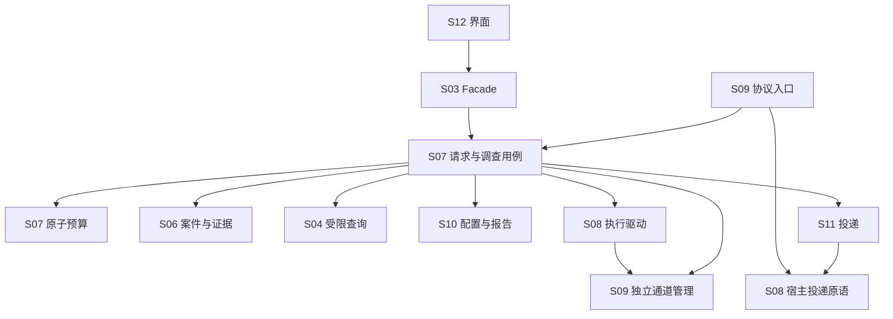

# 子系统边界与变更约束

日期：2026-10-23；工程契约0.2.0；业务基线v4.2。本文是本轮工程修订决定，不是产品实现或真实链路成绩。[模块入口](README.md) · [修订记录](changes-0.2.0.md) · [开发规范](../development/README.md)。

## 1. 边界的判断方式

模块独立表示可以在固定契约下配合共享fake实现和验证，不保证独立部署、独立数据库或任意功能变更只改一包。当前为一个桌面应用、一个核心写入者、一个活动调查。

观察变更传播：新增已有类别的查询handler不应改任务状态机；修改宿主消息格式应留在S08 wire driver；改导出格式不应改执行/取证；改证据保留必须同时验证缓存清理与历史引用。接口数或依赖注入本身不能证明低耦合。

## 2. 实现组件与依赖方向

12个子系统编号不变，内部将通道管理、预算、应用用例和协议入口分开构造。机器可核对的允许依赖、端口和表所有者见[architecture.json](architecture.json)。这是设计约束清单；目前没有产品源码，检查通过不等于已执行源码依赖检查。

图中应用用例是协调者，通道管理是无业务回调的基础组件。S07可以调用通道管理，S09入口可以调用S07；它们不再是同一个网关对象相互回调。S06不依赖S07/S09，S10不依赖S07/S08/S11。

## 3. 状态与数据的唯一负责人

| 决定/数据 | 唯一负责人 | 对方取得什么 |
|---|---|---|
| 请求、JobState、取消/超时/放弃决定 | S07应用协调 | RequestStatus、CompletionDecision |
| 原子预算、run fence | S07预算组件 | 预占回执/明确错误 |
| 源证据、投影、查询覆盖、案件revision | S06 | 不可变版本和明确事务端口 |
| 宿主消息关联与终态核实 | S08 | verification已规范化的ExecutionSnapshot |
| 工具grant/token/可信会话绑定 | S09通道组件 | ChannelHandle；不给模型自选身份 |
| 取证调用幂等、回复缓存、可见步骤 | S07工具用例 | ToolReply；S09只观察实际发送结果 |
| 草案结构/引用校验、人工审核、结果包 | S10 | ReportAssessment；不解释执行或取消 |
| 订阅、outbox、回执和投递状态 | S11 | 独立DeliveryState；不能重跑调查 |

步骤声明、查询事实、模型推断、人工意见保持区别。改变任务终态时不得顺手改变案件解决或人工审核状态。

## 4. 同事务协调的具体边界

| 用例 | 协调位置 | 同一WriteTx必须完成 |
|---|---|---|
| 接收无run告警 | S05 | S06证据保存、收件箱、通知和触发决策 |
| 准备调查 | S07 | seed事件预算、run初始输入、案件baseRevision和尝试预占 |
| 工具返回材料 | S07工具用例 | fence复核、事件预算、S06 capture/project、回复账本 |
| 结束调查 | S07 | manifest、assessment、终态决定、结果包、案件应用、outbox |
| 人工清理 | S07 RetentionService | 当前活动保护集合、S06过期标记、回复缓存EXPIRED |
| 发布人工修订 | S07 ReviewPublicationPort | 来源/双版本核对、新结果版本、outbox |

外部HTTP、模型提交和宿主投递均在事务外；intent先保存，observed后保存。不能用异步事件替代上表原子性。跨所有者写调用其InTx方法，禁止直写他表或在事务内await。

## 5. 证据实际交付与报告输入

S06持有证据/投影；S07持有FrozenRunInput、实际PreparedProfile与步骤。S07在事务中通过inspectRunInTx取得RunEvidenceView，再合并实际交付的冻结contextRefs，形成ReportValidationInput交给S10.proposeInTx。模型只能提交ReportCandidate，不能伪造该校验输入。

初始提示经S08核实消息文字后释放seed；工具响应经S09报告实际发送结果，再由S07释放。metadata和projection的prepared/released/uncertain都参与封存。未知发送不猜测为released。

## 6. 共享持久化与读取

统一数据库用于本地事务正确性。数据库接口包含SQL方法，不等于每个调用方有任意表权限。Repository保持包私有；跨包只导出公共服务、只读视图与明确InTx端口。聚合读取通过声明的只读投影，不建立可选用的第二份可变JSON状态。

产品基座任务需实现源码依赖与SQL访问检查；目前architecture.json仅能核对设计清单、自身DAG和表覆盖。不得把设计检查当成源码隔离已生效。

## 7. 可扩展性的边界

ConnectionProfile中的Indexer/Server配置仍是Wazuh专用，当前只完成窄查询端口隔离，不扩展上游。未来第二平台需另评Scope/身份/能力/来源定位映射，不能只换URL。

活动调查1、独立主体空间、SQLite同步事务和当前能力枚举是首版约束。改变并发不能只改DEFAULT_LIMITS，还需迁移uq_one_active_job、复核宿主并发/恢复/预算；不在本轮自动参数化。

公共契约在实现时按领域子路径组织，保留统一版本及唯一导出来源。外部schema严格校验、授权和晚到响应复核继续保留；减少耦合不能靠任意JSON、取消复核或静默降级。
