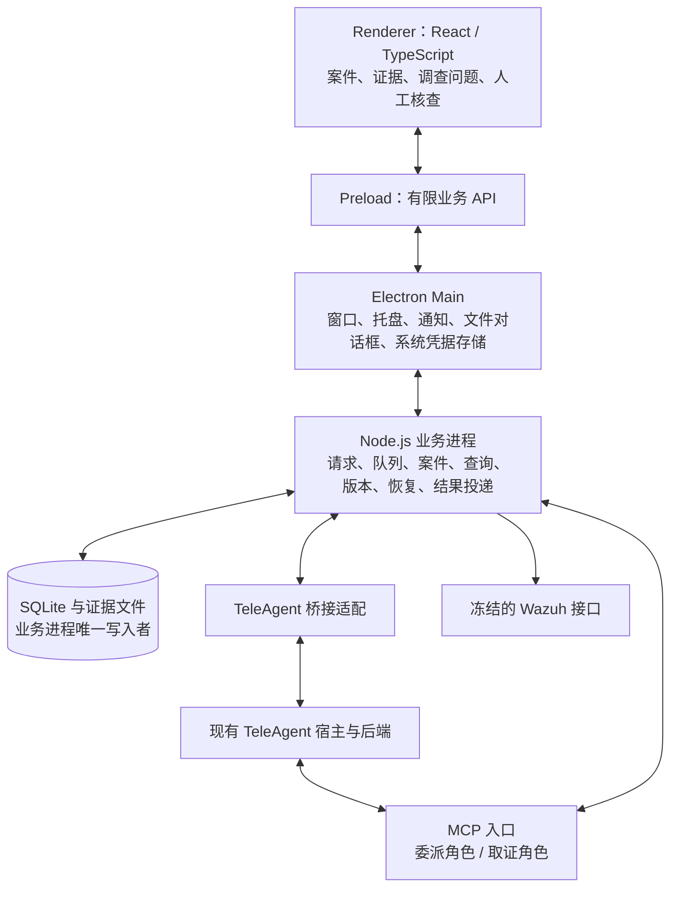

# 校安智脑：客户端、TeleAgent 桥接与 MCP 细化提案

> 资料归属：初始项目材料由 **Shimakaze-17900** 提供并署名，仓库副本由 Codex 辅助整理。外部原件的可访问范围见[来源登记](../reference-index.md)；历史环境观察只适用于原记录，不表示其他成员已复现。

> 整理标记（2026-10-22）：待评审讨论稿；细化建议和创新候选尚未替代 v4.2 基线。
>
> 本副本保留设计内容，补充署名、状态与来源说明；本次维护不构成新业务版本。[来源登记：原始文件](../reference-index.md#source-27) · [统一文档入口](../README.md)

版本：讨论稿 0.1　日期：2026-10-21。

本稿细化 [v4.2 主设计](../current/security-triage-client-design-v4.md)，用于讨论实现结构和作品创新主线，尚未实现或联调。上游 Wazuh 技术方案按用户要求冻结：客户端使用其现有接口与数据，缺少的能力在客户端显示限制。本稿不新增上游组件、日志来源、规则、采集模块或服务端改造要求。既有受限接入待核实项作为接入条件登记，不重新展开上游选型。

v4.2 的三入口、人工核查、预算和恢复要求继续有效。本稿新增的调查结构、版本差异交互属于待选设计；不因写入本文就认定其已经成为完成条件。赛事规则和评分标准尚未取得，创新评价先按系统机制、使用价值、可复现演示和工程完成度考虑。

## 1. 建议先确定的四项决定

| 决定 | 建议 | 原因 |
|---|---|---|
| 客户端工程结构 | Electron + TypeScript；一个独立 Node.js 业务进程 | 窗口生命周期与调查任务分开，UI 与 MCP 共用同一业务核心 |
| Agent 执行位置 | TeleAgent 保留调查循环；客户端负责授权、查询、状态与证据保存 | 让模型选择下一项补证，同时让程序约束可执行范围 |
| MCP 组织 | 委派、取证两个角色；同一核心实现，分别认证和授权 | 来源对话与专用调查会话承担不同任务 |
| 创新主线 | 面向证据不完整场景的可复核、可续查安全调查 | 用同一机制贯穿工具返回、调查过程、人工复核和版本变化 |

前两项是工程推荐；第三项沿用 v4.2；第四项是本轮建议重点评审的产品与系统方向。

## 2. 系统创新应落在什么地方

### 2.1 现有能力与差异空间

自主调查、自然语言解释、可视化依据和人工反馈已有产品实践。Microsoft 的 Phishing Triage Agent 描述了自主研判、依据展示和反馈能力；Google Security Operations 也提供动态取证与调查解释。它们可以作为行业参照，不能据此宣称本项目已经具备相同效果。[Microsoft 官方说明](https://learn.microsoft.com/en-us/defender-xdr/phishing-triage-agent)、[Google 官方说明](https://cloud.google.com/solutions/security/agentic-soc)

显式验证、反证和调查记录也有研究先例。例如 2026-10-07 的 AIDA 预印本研究了取证不足与错误排除问题，并使用独立挑战和调查记录。该论文的结果属于其特定实验，不能迁移成本项目成绩。[论文摘要](https://arxiv.org/abs/2610.10608)

因此，本稿将创新定位为一项待验证的系统贡献：**在固定数据平台、受限权限和有限预算下，把调查中的结论、证据、查询覆盖和人工修订建立明确联系，使使用者能够判断当前能回答什么、还缺什么，以及材料变化后哪些判断需要重查。** 这项定位仍需更完整的相关工作比较，当前不作首创声明。

### 2.2 贯穿三层的调查档案

每个案件有一份可版本化的调查档案，核心对象为：

| 对象 | 示例 | 产生者与限制 |
|---|---|---|
| 调查问题 | 该账号是否存在需要优先核查的登录活动？ | 用户或告警策略提出 |
| 待验证解释 | 运维重试；账号被他人使用 | Agent 提出，始终标为假设，不要求每案机械生成相同数量 |
| 证据与查询 | 某条成功认证；一次查询无匹配；一次查询无权 | 查询事实由程序记录，语义解释由 Agent 或人工提出 |
| 判断 | 可见材料中出现可关联的成功认证 | Agent 草案，引用具体证据和身份匹配条件 |
| 缺口 | 未获准查询后续文件变化；授权说明未核实 | 程序记录能力限制，Agent 补充对问题的影响 |
| 核查事项 | 请确认该时段维护是否覆盖该账号和设备 | 用户跟进；完成状态不证明远端威胁消失 |

判断与证据之间使用支持、冲突、依赖三类关系。查询记录也是档案的一部分：一条“没有匹配记录”的查询只能支持限定范围的描述；403、查询失败、分页未完成不能支持“没有发生”。

关系记录存入普通 SQLite 表，首版用问题列表和依据卡片显示即可。图形展示可以后加，关系的保存与使用不依赖图数据库。

### 2.3 三个相互配合的机制

**机制 A：查询同时交付材料和覆盖说明。** Agent 收到的不只有记录数组，还包括实际设备、时间、来源、分页、新鲜度和限制。客户端用确定性规则阻止把明确的失败状态显示成完整查询；判断是否被材料充分支持仍需人工核验。

**机制 B：下一项查询围绕待解决问题选择。** Agent 在查询时声明要验证哪个问题、查询目的，以及希望区分的解释。客户端记录其选择并执行受控查询。是否查认证、文件变化或设备背景，由实际证据与可用能力决定。首版不计算未经校准的“信息增益分数”，也不让程序提前完成整套调查后交给模型复述。

**机制 C：材料变化后展示判断变化。** 人工补入维护说明、出现新告警或发起复查时，建立新案件版本与新轮次。客户端提示可能受影响的判断，展示哪些判断保留、修订或仍待核实，并保留旧版依据。范围、设备、来源类别与依赖关系可用于筛选候选，但筛选结果不能证明其余判断绝不受影响。

机制 A、B 和基本判断卡片适合先做。机制 C 首先实现用户明确发起的后续轮次与前后对照；自动变化触发、自动最小重查继续留在 P1，保持 v4.2 的自动调查范围。

### 2.4 用一个案例说明作品亮点

同一认证异常问题准备四种材料条件：

| 条件 | 预期调查表现 | 用户可见内容 |
|---|---|---|
| 有身份一致的后续成功 | 继续核查该成功与后续活动，保留关联条件 | 为什么继续查、成功记录及身份匹配依据 |
| 完成获准查询但无匹配成功 | 限定为本次可见范围无匹配，不推导绝对不存在 | 查询范围、来源覆盖和仍未解决的问题 |
| 没有成功认证查询权限 | 明确无法验证该方向，可转向其他有价值问题 | 权限缺口及其对结论的影响 |
| 新增已核实维护说明，但仍有冲突材料 | 新轮次同时考虑说明与冲突，不自动排除风险 | 说明适用范围、前后判断变化与待核查项 |

这些条件是实验变体；授权说明必须有来源与适用范围。历史档案回放与真实平台查询分别标识，演示不修改冻结上游来伪装产生某种结果。

## 3. Electron 与 Node.js 的具体组织

### 3.1 进程模型



业务进程建议由 `utilityProcess.fork` 启动，通过消息通道与主进程通信。Electron 官方提供该 Node.js 子进程机制；选择它是为了进程职责和故障处理，不等于获得操作系统级安全沙箱。[进程模型](https://www.electronjs.org/docs/latest/tutorial/process-model)、[utilityProcess](https://www.electronjs.org/docs/latest/api/utility-process)

业务核心组织为进程内模块。MCP 监听器、平台适配、桥接和调度器先运行在同一业务进程，不分别部署为服务。数据库操作保持短事务；需要大批量导出时分批处理，避免阻塞查询、取消和工具请求。

### 3.2 技术选择与边界

| 部位 | 首选候选 | 本轮需要落实的限制 |
|---|---|---|
| 桌面壳 | Electron，Windows x64 首验 | 固定实际 Electron 与内嵌 Node 版本，验证安装包 |
| 界面 | React + TypeScript + Vite | 生产只加载打包资源，业务数据经 IPC；开发服务器只用于开发 |
| 业务核心 | TypeScript，独立 Node.js 进程 | 不依赖 React 或 BrowserWindow，可用合成适配器独立运行 |
| 契约校验 | Zod 与可导出的 JSON Schema | IPC、MCP、平台响应与报告均做运行时校验；静态类型不代替校验 |
| 存储 | SQLite、显式 SQL 迁移；优先验证 better-sqlite3 | 驱动作为候选，先验证 Electron ABI、utility process 加载和打包后重启 |
| MCP | 官方 TypeScript SDK 的兼容版本 | 以 TeleAgent 实际协议协商和传输测试锁定版本 |
| UI 状态 | 后端快照加事件订阅；局部表单状态在界面 | 界面不自行维护第二套任务状态机 |

React 官方列有 Vite 的 TypeScript 起步方式，Zod 支持运行时 schema 校验；这里选用它们是工程取舍。[React 文档](https://react.dev/learn/build-a-react-app-from-scratch)、[Zod 文档](https://zod.dev/basics)

SQLite 驱动需要按 Electron 环境处理兼容性，先做一次打包后的读写与恢复验证，再冻结驱动。[better-sqlite3 排障说明](https://github.com/WiseLibs/better-sqlite3/blob/master/docs/troubleshooting.md)

MCP SDK 已有不同代际和包结构，不能直接复制旧代码中的包名后升级到最新版本。实现前保存选用 SDK、协商协议、工具返回和认证传递的兼容矩阵。[官方 SDK](https://github.com/modelcontextprotocol/typescript-sdk)

### 3.3 有限 IPC 契约

Preload 暴露 `window.campusSec` 的业务方法，例如：

```typescript
investigations.create(input)
investigations.getSnapshot({ requestId })
investigations.cancel({ requestId, reason })
investigations.submitInput({ requestId, input })
cases.get({ caseId })
cases.reviewClaim({ caseId, revision, claimId, review })
cases.export({ caseId, revision, format })
events.subscribe({ afterSeq }, onEvent) // 返回取消订阅函数
```

方法名是应用契约草案，不是原生 Electron API。主进程检查发送窗口与 frame，核心再检查当前主体、案件权限和版本。界面不传 SQL、任意 URL、命令或可直接访问的文件路径；导出位置由主进程的文件对话框确定。只将业务 DTO 交给回调，不暴露原始 IPC event。[Electron IPC 安全要求](https://www.electronjs.org/docs/latest/tutorial/security)

渲染进程开启上下文隔离和沙箱，关闭 Node 集成；日志和模型文字按不可信内容显示。连接表单的临时输入经专用操作转交后清空，不缓存已有宿主签名密钥。保存凭据时由主进程调用系统保护存储，核心只取得当前运行所需材料。

请求信封统一包含 `requestId / protocolVersion / method / payload`；结果包含 `ok / data / error`。业务事件包含 `seq / type / principalSpace / aggregateId / revision / occurredAt / payload`。先保存业务变更和必要事件，再发布通知。

UI 初次进入取快照，并从快照的事件序号继续订阅；重连按序号补齐。超出事件留存范围时重取快照。重复事件按序号忽略，频繁文本进展合并刷新。此处只为恢复与同步保存必要事件，不建设完整事件溯源框架。

### 3.4 生命周期

应用使用单实例锁，主进程管理一个业务进程。窗口关闭后是否驻留托盘沿用显式设置；业务进程依附应用，不安装独立系统服务。

业务进程退出时，主进程展示不可用状态并停止受理新工作。受控重启后从数据库恢复：未提交任务按原规则待恢复，已提交任务先核实原会话。不能因为后台进程重启就重新创建调查。应用完全退出后不保证继续接收或投递。

## 4. TeleAgent 桥接层

### 4.1 拆成四个职责

| 接口 | 负责什么 | 不确定性放在哪里 |
|---|---|---|
| HostAccess | 获得端点、签名操作、宿主身份及能力记录 | 合法凭据来源、身份粒度、重连与失效 |
| TeleAgentClient | 编码路径、签名请求、解码响应、SSE 与消息读取 | 固定版本的实际 API 差异 |
| InvestigationDriver | 创建调查会话、提交、匹配消息、核实终态、取消与恢复 | 提交不确定、会话锁、正常完成判定 |
| OriginDelivery | 绑定来源、排队投递、核实消息身份、去重与恢复 | 来源身份和异步回传是否实际受支持 |

这些是本项目的适配接口，不能当作 TeleAgent 已有的公开能力。HostAccess 先返回明确的能力与验证记录，例如 `signedApi / dedicatedProfile / isolatedEvidenceChannel / trustedOrigin / asyncDelivery / deliveryReconcile`，每项保存 available、unavailable 或 unverified 及版本、依据。

### 4.2 已有依据与实现顺序

已有本地研究证明 TeleAgent 2.7.0 的签名 API、会话创建、异步提交、消息读取、SSE 和中止；真实桌面验证仅完成一次合成案例的纯文本轮次。模拟 MCP 成功使用的是隔离后端启动配置，未证明现有桌面可按会话配置独立工具通道。[来源登记：隔离验证](../reference-index.md#source-04)、[来源登记：真实文本验证](../reference-index.md#source-03)

因此先做四个小验证：

1. Node.js 适配器在自行管理密钥的隔离实例中完成签名与正常文本轮次；随后验证现有宿主的明确接入方式。
2. 专用调查配置实际加载，通用工具被拒绝；调查会话可使用专属于本轮的工具授权通道。
3. 来源对话调用委派工具时，能从可信宿主或独立绑定取得真实来源身份；调查会话可独立运行。
4. 已保存结果能回到正确来源对话；忙碌、回执丢失与重启时能核实并避免重复展示。

现有研究中的进程环境读取属于获授权实验方法，本稿不把它设计为默认安装流程。若现有宿主接口没有某项能力，桥接层必须报告缺口；单独增加一个 TypeScript 接口不能补出宿主能力。不通过的来源回传项仍不满足 v4.2 的全部 P0。

### 4.3 每轮启动与完成的顺序

```text
校验主体、范围、来源、预算与能力
  → 保存 run 与提交意图
  → 建立专用配置和本轮工具授权上下文
  → 创建 TeleAgent 会话，保存真实 session_id
  → 将工具通道与该调查绑定并核对权限
  → 提交问题、范围、能力目录、种子与已审核背景
  → 从消息确认本次用户请求进入会话
  → 跟踪 SSE；按需回读本会话消息
  → 收集工具结果和候选草案
  → 核实对应助手正常终结，撤销工具上下文
  → 封存输入清单、校验草案、保存结果和待投递记录
```

每轮映射保存 `request_id → case_id → run_id → session_id → user_message_id → result_message_id`，来源绑定单独保存。业务 run_id 不替代后端 messageID。

签名按本地实测的最终编码路径与查询串生成，重试使用新时间戳和 nonce；签名能力只接受桥接层白名单操作。创建或提交后断线转为 `uncertain`，优先回读已知会话，不能盲目重提。若创建响应丢失且没有可验证的会话核对机制，保留待核实状态，不枚举个人全部会话来猜测。

HTTP 204、SSE 的 idle、已有文字、`propose_report` 成功均不能单独证明调查完成。需关联当前用户消息和助手回复，核对完成字段、结束原因及错误，再做业务校验。SSE 主要用于进度，消息记录用于核实结果。

### 4.4 结果投递

调查结果与待投递记录同事务保存，之后调用宿主。投递键由来源绑定、请求、轮次和结果版本组成。调查执行状态与投递状态分开；重投递不重跑调查。

来源身份必须从可信宿主元数据或已验证的独立通道取得，模型传入的 `session_id` 只可作一致性检查。结果包包含问题、范围、主要判断、依据、缺口、审核状态和任务身份。投递前复核主体与来源绑定，回执不确定时先核实；只取得 API 接受响应不记 delivered。

MCP 的普通工具返回与宿主稍后通知原对话是两个环节。版本化 MCP 规范中已有需要协商的 Tasks 机制，但它不能自动补足 TeleAgent 的来源识别和对话通知能力；本项目不以采用该机制作为现有问题已解决的依据。[MCP Tasks 参考](https://modelcontextprotocol.io/specification/2025-11-25/basic/utilities/tasks)

## 5. MCP 工具设计

### 5.1 两个角色如何落地

| 角色 | 调用者 | 认证后得到的上下文 | 允许动作 |
|---|---|---|---|
| 委派 | TeleAgent 发起对话 | 主体、工作区、来源绑定、可委派范围 | 提交、补充、状态、结果、取消 |
| 取证 | 本应用创建的调查会话 | 主体、run、范围、预算、有效期、连接代次 | 有界取证、记录调查进展、提交候选草案 |

同一个业务进程可以提供两个 MCP endpoint，但两个角色分别认证与授权。`tools/list` 过滤可见工具，每次 `tools/call` 再做授权。独立 URL、工具名称或 run_id 本身不构成隔离。

传输先验证本机 Streamable HTTP，使用实际兼容的协议版本，绑定回环地址并验证 Origin。若宿主支持独立 stdio 启动配置，可以用受控子进程通道作为另一候选，但仍需证明角色与本轮绑定。两种传输都不能凭名称推定已有会话隔离。[版本化传输规范](https://modelcontextprotocol.io/specification/2025-11-25/basic/transports)

核心生成短期本轮授权，保存摘要、范围、有效期和撤销状态；通过已验证的宿主配置或启动通道交付给对应 MCP 连接，不放在提示、工具参数、URL 或日志里。工具服务使用自己持有的平台连接，不转发 TeleAgent token 给 Wazuh。

全局 MCP 连接若只能使用一个共享应用密钥，必须继续验证它是否提供可信的调用会话身份。没有该身份时，不能将共享连接绑定到一个可变的“当前案件”。`Mcp-Session-Id` 用于协议会话管理，不作为认证凭据。[MCP 会话安全说明](https://modelcontextprotocol.io/docs/2025-11-25/tutorials/security/security_best_practices)

### 5.2 复用现有工具，细化契约

委派端继续使用 v4.2 的六个工具：`list_investigation_scope`、`request_investigation`、`provide_investigation_input`、`get_investigation_status`、`get_investigation_result`、`cancel_investigation`。所有业务方法与 UI 共用。缺设备、时间或身份歧义时返回 needs_input，补齐前不创建调查会话。

取证端按以下方式细化，保持工具粒度清晰：

| 工具 | 关键参数或补充 | 必须返回或保存 |
|---|---|---|
| get_case_context | 已认证 run 上下文；模型不选择另一个案件 | 问题、范围、能力、种子、背景及版本、预算 |
| search_related_alerts | 设备、时间、受控条件；question_id、purpose | 有界记录、证据引用、覆盖与页信息 |
| search_authentication_events | 命名空间明确的身份、结果类型、查询目的 | 身份匹配字段、来源、覆盖；不强行跨身份关联 |
| get_evidence | 本轮已知 evidence_id、view_id | 本轮实际可用详情与来源，不扩大到其他案件 |
| get_host_inventory | 已开放类别与设备 | 来源时间与清单语义，不充当行为历史 |
| search_file_changes | 设备、时间、受控字段条件 | 已存在的变化记录，不读取远端文件 |
| get_host_findings | 已开放发现类别 | 漏洞或配置检查的现有结果与时效 |
| record_investigation_step | 问题、假设或判断的有限更新、支持/冲突引用、下一步或停止摘要 | Agent 声明与版本；引用合法性检查 |
| propose_report | judgment_ids、支持/冲突、缺口、核查事项、停止原因 | 候选报告、校验结果；不修改人工审核或案件解决状态 |

`record_investigation_step` 的结构化更新是对现有工具的候选扩展，替代散落的纯进展文字；不另加一套工具。查询可以携带同类简短进展信息，避免每次查询都额外消耗一次调用。假设最多保留少量当前候选，历史变更留在记录中，不要求模型输出私有思维链。

### 5.3 查询结果统一信封

以下 JSON 是合成示例，展示分页未完成时的返回结构：

```json
{
  "schema_version": "1.0",
  "query_id": "Q-003",
  "status": "partial",
  "question_id": "IQ-1",
  "records": [
    {
      "evidence_id": "E-021",
      "view_id": "EV-021-1",
      "kind": "authentication_event",
      "summary": "已采集的成功认证记录，身份关联待核查"
    }
  ],
  "coverage": {
    "requested_scope": {
      "host_ids": ["001"],
      "from": "2026-10-21T02:00:00Z",
      "to": "2026-10-21T02:10:00Z"
    },
    "effective_scope": {
      "host_ids": ["001"],
      "from": "2026-10-21T02:00:00Z",
      "to": "2026-10-21T02:10:00Z"
    },
    "source_types": ["archives"],
    "query_completeness": "partial",
    "collection_coverage": "unknown",
    "reasons": ["remaining_pages"]
  },
  "page": {"next_cursor": "opaque-cursor", "has_more": true},
  "retrieved_at": "2026-10-21T02:11:00Z",
  "budget": {"platform_requests_remaining": 17},
  "warnings": ["不能根据当前页判断完整时间窗内的成功认证总数"]
}
```

`status` 至少区分 ok、partial、denied、unavailable、failed；完整查询零匹配可用 ok 加空数组表达，同时保留采集覆盖未知等限制。查询完整与采集完整是两个字段，不能合并。

分页游标由服务端生成并绑定主体、run、查询条件与有效期；下一页不得改变条件。平台查询和分页重试均计预算，缓存命中仍计工具执行。沿用 v4.2 的并发、查询量、文本长度和有效期起始限制。

### 5.4 证据保存与模型实际可见内容

平台响应先经过字段白名单与大小限制，保存本地快照，再构造交付给模型的视图。`evidence_id` 指向取得时快照，`view_id` 指向本轮实际返回的字段与摘要。两者保存关系，后续增加详情产生新视图。

模型引用必须能定位本轮交付视图。程序发现引用字段未在任何已交付视图出现时，应拦截或标明，而不能因为完整内容存在本地就认为模型已经读取。自然语言断言与字段之间的语义支持仍需人工核验。

MCP 工具定义包含 inputSchema，兼容时提供 outputSchema 和 structuredContent；同时提供有界文本 JSON，适配已研究 TeleAgent 的 content 读取路径。SDK、输出结构与文本大小一起实测。[版本化工具规范](https://modelcontextprotocol.io/specification/2025-11-25/server/tools)

预算预占与授权检查在发起查询前原子完成；外部请求不占数据库事务。平台响应返回后，再检查取消、授权代次与有效期：已失效的调用不继续向模型交付新材料。工具错误使用协议错误或 isError；正常执行但无匹配属于业务结果，不能混写。

## 6. 案件、调查档案与界面

### 6.1 在 v4.2 对象上增加少量结构

| 对象 | 关键字段 | 为什么保存 |
|---|---|---|
| investigation_questions | id、run、问题、范围、状态、来源 | 将工具选择和报告关联到具体问题 |
| hypotheses / judgments | id、run、文本、类别、声明者、版本 | 将假设、模型判断与人工结论区分 |
| judgment_links | judgment、evidence/query/view、支持/冲突/依赖 | 点击判断直接查看材料与覆盖 |
| evidence_views | evidence、run、投影版本、实际交付内容、摘要 | 核对模型实际读过什么 |
| judgment_changes | 前后版本、变化类型、原因、人工审核 | 解释后续调查如何改变判断 |

这些可以先作为少量表或有 schema 的结构化字段实现，避免提前建设通用知识图谱。业务修改、证据引用、工具调用和审核分别保存，不将 Agent 自述“已查”写成真实查询记录。

### 6.2 调查工作台

导航沿用总览、告警、设备、案件、核查、设置。案件工作台重点展示：

```text
顶部：问题、设备、绝对时间范围、来源、任务状态、已覆盖到何时

左侧：时间线与证据        中间：问题与调查进展        右侧：判断与核查
原记录与背景              当前待验证解释              支持、冲突、未知
查询条件与采集时间        正在解决的问题              引用与审核操作
缺权、分页、过期提示      下一项补证的简短目的        核查事项、结果版本

底部：队列与预算、停止、后续输入、投递状态
```

用户点击一条判断，联动显示支持和冲突材料、相关查询及限制。普通用户先看到“还缺什么、需要确认什么”，协议错误和哈希放在诊断详情。调查进展是可核查的操作摘要，不展示或声称保存模型私有思维链。

### 6.3 补充材料与后续轮次

活动轮次输入不变。用户补入说明后保存新案件版本，界面明确显示“下一轮将使用”，可等待当前轮次结束，或显式停止后发起新轮次。

后续轮次携带已审核背景、旧判断的审核状态、原证据取得时间和新问题。旧查询不能伪装成当前查询；权限过期、时间变化或需要证明当前状态时重新核实。旧轮次的完整输入和输出继续可查。

判断变化至少分为保留、修订、新增、待复核。模型声明变化理由，程序检查引用与版本。首次实现由用户发起复查，系统提供前后对照；基于依赖筛选的局部重查是后续实验项，尚不承诺节省比例或全局完整性。

## 7. 代码目录与依赖方向

```text
apps/desktop/
  main/                 窗口、托盘、凭据、导出与进程管理
  preload/              有限 IPC 包装
  renderer/             页面、表单与证据交互
  runtime/              Node.js 业务进程入口与组装
packages/
  contracts/            IPC、MCP、领域 DTO 与 schema
  core/                 请求、案件、调度、预算、调查档案、投递
  storage/              SQLite、迁移、证据文件、必要事件
  wazuh-adapter/        冻结接口的受控适配与覆盖描述
  teleagent-bridge/     HostAccess、HTTP、执行驱动、来源投递
  mcp-server/           两角色传输、认证与工具注册
  investigation-profile/ 专用 Agent 提示、Skill 与版本清单
fixtures/               合成响应、权限与分页变体，明确标为实验
```

目录可以在同一仓库内组织，不要求每个目录都发布为 npm 包。依赖方向为 UI/MCP → 应用用例 → 领域规则 → 适配接口；存储、Wazuh、TeleAgent 是接口实现。核心不 import Electron，Renderer 不 import 平台和数据库适配器。首版用显式组装与少量接口完成依赖注入。

## 8. 怎样证明这条创新主线有用

在原 [实验附录](../current/security-triage-client-experiments-v4.md) A/B/C 对照上增加 C0/C1，单独检验结构化调查档案的收益：

| 组别 | 行为 | 用途 |
|---|---|---|
| A | 现有面板人工核查 | 了解实际流程 |
| B | 固定查询与模板，无模型 | 分离界面和证据整理收益 |
| C0 | 相同工具、权限、预算的普通工具调查 Agent | 检验基础 Agent 调查 |
| C1 | C0 加覆盖说明、问题/判断关系、版本对照 | 检验本稿组合机制的增益与成本 |

C0/C1 使用相同底层查询和可获得材料，记录实际取得的输入。结构化信息和提示引起的 token 开销也计入。若需区分各机制贡献，再做小规模消融，不必首轮穷举所有组合。

先准备约 12—20 个可核查变体作为预实验候选，覆盖成功认证、身份不一致、权限缺失、完整零匹配、分页中断、冲突授权说明和材料变化。根据额度对关键变体重复运行；公布样本数、运行次数、未完成与人工帮助，不把小样本包装成普遍结论。

优先指标：

1. **无依据排除风险的比例**：将缺权、失败或部分数据写成“确认良性/无需核查”的次数；由独立复核而非模型自评分。
2. **重要依据与冲突遗漏**：依据事先明确的核查目标，评估应该发现的可见材料及关键缺口。
3. **人工复核成本**：定位某项判断依据、完成修订和交接的时间，必要修改量。
4. **证据变化响应**：改变成功记录、权限或有效背景后，后续查询、停止原因与判断是否合理改变。
5. **后续轮次成本**：版本对照与局部复查相对完整重查的查询、耗时与 usage；收益以实验为准。

人工结论允许仍未知。采集缺口的诚实表达可以是正确结果，但不能靠一律输出“证据不足”获得高分，需同时评估可回答问题是否得到回答、可用重要证据是否被找到。高校价值通过授权实验、维护时间和交接角色等实际背景体现，不能只替换产品名称。

## 9. 建议实施顺序与当前可冻结项

| 次序 | 交付物 | 到此能确认什么 |
|---|---|---|
| 1 | 现有 TeleAgent 的认证、专用工具通道、可信来源与回传小验证 | 区分已可实现的桥接能力和缺口；沿用 M0 判定 |
| 2 | Electron → 主进程 → 业务进程 → SQLite 的最小安装包 | 进程、IPC、驱动与重启机制可运行 |
| 3 | 一个调查问题、一次真实受控查询、证据视图与判断卡片 | UI 和 MCP 共用核心，查询和证据可核对 |
| 4 | 真实 TeleAgent 多轮取证及两个材料分支 | Agent 根据证据选择后续行为 |
| 5 | 三入口、投递恢复与人工核查；用户发起的版本对照 | 主流程与现有 P0 验收对齐 |
| 6 | 对照实验，按结果决定局部重查等增强 | 支撑创新主张与实际收益 |

现在适合固定：Electron/TypeScript 方向、一个业务核心、进程职责、两角色 MCP、请求/轮次/投递分离、证据与覆盖一起交付。

现在应保留验证空间：具体 Electron 与 SQLite 驱动版本、MCP SDK 与传输兼容性、宿主认证来源、每轮工具隔离和原对话通知机制。调查档案与版本对照作为创新候选先做一个可操作样例，再决定是否纳入下一版正式基线。

当前完成的是设计细化与公开资料核对，没有安装依赖、调用真实模型、修改 TeleAgent 或冻结的 Wazuh 配置。
