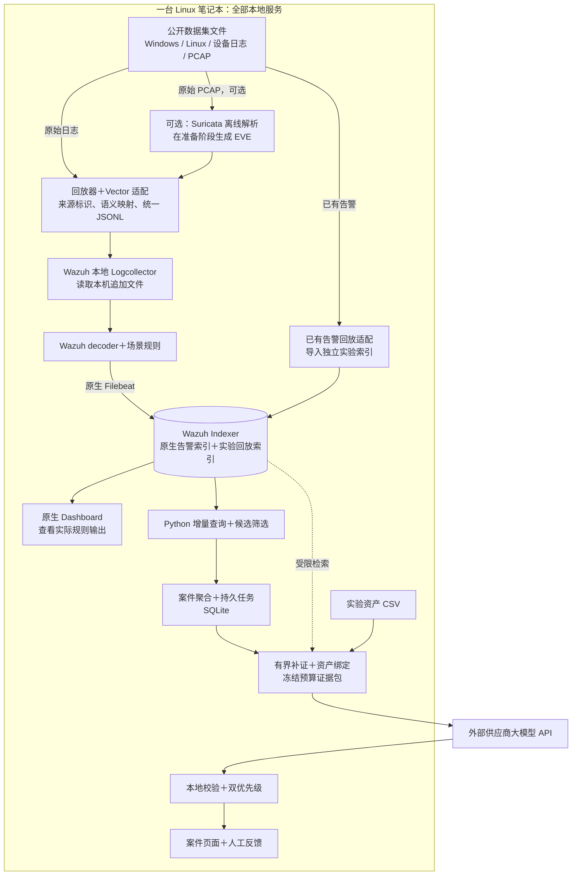

# 多源安全日志智能研判系统：单机部署与公开数据集验证方案

> 整理标记（2026-10-22）：历史 v3；已被 v4.2 替代，保留用于追溯。
>
> 本副本仅增加状态说明并调整本地链接，未改写方案正文。[原始文件](../reference-index.md#source-19) · [统一文档入口](../README.md)

> 历史版本，2026-10-20 更新入口：当前实施设计以 [v4.1 受限调查客户端](../current/security-triage-client-design-v4.md)及[实验附录](../current/security-triage-client-experiments-v4.md)为准。本文件保留 v3 单机设计供比较，以下部署、排期与能力不作为当前承诺。

**版本**：3.0，2026-10-19，单机部署历史方案。  
**本轮变更**：全部本地服务部署到一台笔记本；Windows/Linux、网络安全设备和流量均可来自已有公开数据集。  
**资源约束**：约 Intel 13 代 i7，16 至 32 GB 内存，无 GPU；通过外部供应商 API 使用大模型。  
**交付形式**：Markdown 设计文档。本次不提供程序、配置代码或安装脚本，不进行软件安装、数据下载或真实 API 调用。

## 1 首周部署决策

推荐选一台 **32 GB 内存、SSD 空间较充足的 Linux 笔记本**，集中运行 Wazuh Manager、Indexer、Dashboard、原生 Filebeat、必要的 Vector 适配，以及一个 Python 研判服务。其余三台笔记本可供开发、查看页面或保存材料，不承担必需服务。

Windows 日志是数据来源，不要求服务器运行 Windows，也不要求在实验中另建一台 Windows 主机。首周验证的是数据集文件的解析、检测与研判链路；原生 Windows Agent 在线采集仍属于后续接入验证。

| 原设计 | 单机首周版 |
|---|---|
| 四台电脑分别承担接入、检测、证据和研判 | 同一 Linux 主机中的进程、目录和本机服务 |
| Kafka 部署在独立弱服务器 | 默认不部署 Kafka，以告警增量查询和 SQLite 持久任务完成闭环 |
| 依赖在线设备持续产生日志 | 公开数据集按时间顺序和指定速率回放 |
| Suricata 作为在线流量处理节点 | 按需在准备阶段离线读取 PCAP，生成记录后再回放 |
| 以在线 Agent 身份绑定资产 | 按数据集中的真实来源、主机、账号和地址绑定实验资产 |

Kafka 保留为后续可选的本机组件或扩展阶段组件。单机首周先验证数据与研判；已有案件任务本身已经需要持久化，不额外引入消息中间件作为硬依赖。如果后续启用 Kafka，其消费入口替换增量查询入口，同一批候选不双路消费。

Wazuh 官方提供中央组件同机部署方式，其小规模硬件参考不能直接换算成本项目 EPS。实际组件版本、系统支持与可用磁盘在 D1 验证后冻结。[Wazuh Quickstart](https://documentation.wazuh.com/current/quickstart.html)

## 2 推荐公开数据集及使用顺序

### 2.1 主线：AIT Alert Data Set，简称 AIT-ADS

推荐先取 **russellmitchell** 场景，优先适配其中的 Wazuh/Suricata 告警文件。数据集整体压缩包约 **96.2 MB**，来自 Wazuh、Suricata 和 AMiner，包含正常行为误报、异构字段和攻击阶段标注；该场景合计约 **45,544 条告警**，适合先跑通告警聚合与研判。[发布者数据页](https://zenodo.org/records/8263181)

这一路输入本来就是告警，直接经过告警适配与案件入口，不把它重新当作原始 Windows/Linux 日志交给 Wazuh 重复检测。它验证告警接入、格式兼容、资产关联、证据压缩和 API 研判，不能证明原始数据检测召回率。

先不接入 AMiner 格式，避免同时适配更多告警结构；后续可用它检查新来源适配能力。

### 2.2 原始日志与同场景跨源证据：AIT Log Data Set V2.0

用于补测认证、审计、网络安全日志与 PCAP 的原始处理路径。其主机日志、流量和标签来自同一实验网络，适合保留真实的跨源关系。推荐与告警主线对应的 **russellmitchell** 场景；该包约 **7.1 GB**，解压后约 **14 GB**，首周只选少量主机和连续时段。[原始数据发布页](https://zenodo.org/records/5789064)

这是模拟实验环境数据，不代表真实高校网络。不同版本、原始日志与衍生告警之间的具体对应关系需要核对，不能只凭名字相同就假设每条告警都有一一对应的原文。

### 2.3 Windows：OTRF Security Datasets

补充 Windows 安全事件的字段适配与小场景验证。优先选择可直接读取的结构化事件样本，只取一至两个与首周规则相符的案例。[OTRF 项目](https://github.com/OTRF/Security-Datasets)、[Windows 样本目录](https://securitydatasets.com/notebooks/atomic/windows/intro.html)

D1 必须检查真实字段和事件类型。某个 Windows 样本不一定包含 4624/4625 或连续认证失败；没有这些事件就只验收其实际提供的字段与场景，不补造认证事实。JSON 形式的 Windows 样本也不等同于已经验证 Windows eventchannel 原生采集。

### 2.4 Linux 小规模备用：Loghub Linux / OpenSSH

适合先验证文本解析、时间处理及背景日志回放，尤其适合作为原始大包暂未下载时的启动数据。它不自动提供首周所有攻击的逐条真值；未标注样本不直接当作已核实正常。[Loghub 官方项目](https://github.com/logpai/loghub)

不能把所有标为 Windows 的系统日志语料都当作安全认证日志，应先检查是否真的包含目标事件。

### 2.5 流量备用：CIC-IDS2017

只有在需要额外网络流量案例时再选小段 PCAP。官方同时提供 PCAP 和标注流 CSV；流特征 CSV 不等于原始报文，也不等于安全设备原生日志。[CIC-IDS2017 官方页](https://www.unb.ca/cic/datasets/ids-2017.html)

首周已有 AIT 片段满足需要时，不再增加这个数据集。不能从网络流量特征凭空恢复 Windows 事件、Linux 登录结果或某厂商告警。

### 2.6 首日选择清单

| 优先级 | 数据 | 首周用途 |
|---|---|---|
| 必选 | AIT-ADS 一个场景的选定告警格式 | 快速跑通主要研判闭环 |
| 必选 | 少量 Windows 结构化事件 | 验证异构来源及统一字段规则 |
| 必选 | Linux 认证原文，优先同场景 AIT，备用 Loghub | 验证原始文本路径与规则边界 |
| 按空间和时间选择 | 同场景原始网络日志或小段 PCAP | 补测原始检测与跨源追溯 |
| 后续扩展 | 其他 AIT 场景、AMiner、CIC-IDS2017 | 做外部评估，首周不全量接入 |

选择完成后记录：数据集/场景版本、下载来源、文件校验值、格式、时间范围、字段覆盖、标注粒度及使用许可。原始数据只读保存，实验产物放到独立目录。

## 3 单机架构

### 3.1 三种输入按数据粒度分路

外部仅保留供应商 API；公开数据下载后在本机回放。原始日志、已有告警与 PCAP 是三种数据粒度，不是把 Windows、Linux、网络设备分成互不关联的系统。

### 3.2 原始日志路径

样本逐条解析并映射为统一事件，按速率追加到回放文件，交给 Wazuh 本地 Logcollector 读取，再执行 JSON 解码和配套语义规则。Manager 主机使用自身本地采集能力，不要求在同一操作系统再安装第二套 Agent 包。[Wazuh localfile 说明](https://documentation.wazuh.com/current/user-manual/reference/ossec-conf/localfile.html)

采集模块默认启动和历史读取行为需实际核对。首周采用“先启动并确认采集器，再追加本 run 数据”的方式，避免把历史文件放在那里就误认为已经被完整读取；停止、续读、文件轮转均需验证。

### 3.3 已有告警路径

AIT-ADS 等已有告警经字段适配后，写入单独的实验回放索引；使用受控索引模板和导入权限，不覆盖 Wazuh 管理的原生索引。Python 查询适配器分别读取本 run 的原生与实验索引，统一为相同案件输入。

原生 Dashboard 默认视图未必显示实验索引；首周案件页面必须标明输入模式，并提供相应证据详情。可选增加独立查询视图，不把回放告警伪装成当前检测引擎的新发现。

### 3.4 PCAP 路径

Suricata 支持离线读取 PCAP。首周先离线生成 EVE，再回放这些记录，避免报文解析与索引压测在同一台笔记本争用资源。[Suricata 离线模式](https://docs.suricata.io/en/latest/command-line-options.html#cmdoption-r)

记录 PCAP 标识、流/报文定位、Suricata 和规则集版本。当前版本生成的告警不保证与数据集中旧版本的衍生告警相同。仅回放已有 EVE 不计为验证了本机报文检测；离线生成成功也不等于证明了在线镜像带宽承载能力。

## 4 数据准备、混合与标签隔离

### 4.1 每条记录保留的身份

| 字段 | 作用 |
|---|---|
| dataset_id、scenario_id、run_id | 数据集、场景和独立实验 |
| event_id、source_record_id | 稳定记录身份和原始位置 |
| origin_device_id、observer_id | 实际来源与观察者，不使用单机采集器身份替代 |
| namespace | 默认由数据集和场景确定的网络空间 |
| original_time、replay_time、ingest_time | 原时间、映射时间与接收时间 |
| event_category/action/outcome | 已验证的统一行为语义 |
| src_ip/dst_ip、target_entity_id、account_scope/name | 真实行为实体，未知时不补造 |
| input_mode | raw_log、replayed_alert 或 pcap_derived |
| mapping_version、quality_flags、raw_locator | 可复现适配与证据追溯 |

同样的私网地址在不同数据集可能属于不同设备，默认按 namespace 隔离。不能把两个无关数据集的同 IP、同账号名和近似时间拼成一条真实攻击链。

需要展示真实跨源关联时，优先使用同一场景的主机、网络与告警数据。人为拼接的跨源测试单列为合成集成测试。

### 4.2 真值不进入检测和 LLM 输入

标注文件、攻击阶段答案、数据集标签和解答说明仅供离线评估器读取。准备数据时建立原始位置与评估真值的关联，但不把真值字段写入规范事件、候选筛选条件或模型证据包。

数据文件名或目录若直接暴露攻击答案，对模型只提供不含答案的证据 ID；原始路径仍可在本地追溯。攻击控制脚本和演练答案不作为普通受监测日志输入。

真实 IDS 输出的签名、规则名与严重性属于可用观测，不等同于数据集真值；可保留，但报告要说明评估的是已有检测结果之后的分诊能力。

AIT 原始标注依赖原文件位置时，先建立位置映射，再裁剪/重排；保留原始行号或行范围。审计多行合并仍需关联回原记录，不能用裁剪后的新行号错误对齐标签。

### 4.3 资产表

依据数据集提供的主机/地址信息建立实验资产清单，保留 dataset/scenario/namespace、origin_device_id、主机别名、地址有效期、角色与重要性。重要性属于演示策略时标明 criticality_source=demo，不伪称高校真实 CMDB。

不能把数据集答案中的“攻击者主机”预先当成恶意标签加入模型上下文。资产关系冲突、NAT 或共享地址不能确定时保留 ambiguous/unresolved。

### 4.4 格式与语义适配

继续使用“来源登记 → 格式识别 → 解析 → 语义映射 → 规则适配”。已有 Wazuh 原生格式可复用其 decoder；自定义 JSON 配置相应场景规则，不能假设 JSON 解码成功后所有内置规则自动生效。

基本映射至少覆盖：认证失败、认证成功、约定设备安全告警和输入模式。防火墙拒绝连接不自动映射为攻击；未知格式隔离保存并计数，不归为正常，也不批量交给 API 猜测。

同一个真实事件的多个观察副本不直接累加为多次认证失败。每个计数场景明确主要计数来源和辅助证据来源。

## 5 回放方式与时间语义

### 5.1 功能与正确性回放

采用可复现的事件顺序和时间映射；使用 1 倍相对时序或选定的短连续窗口验证频率规则。保留原始时间，映射后的时间及投递节奏另外记录。Wazuh 实际窗口语义在安装版本中通过边界测试确认，不假设改消息时间戳就等于改变规则引擎时钟。

单次 run 固定场景、适配版本、时钟映射、规则版本和随机种子。重复验证相同证据可复用冻结输入；独立重演采用新 run，隔离检测状态和案件。

### 5.2 吞吐回放

可按 50、100、200、500 EPS 逐级调速，但这类加速会改变时间窗内的事件密度，不能直接复用功能回放的规则精度结论。记录不足而重复循环时，记录重复倍数和性能实验标识，重复记录不计入独立准确率样本量。

PCAP 离线解析速度、原始日志检测 EPS、已有告警导入 EPS 和案件分诊速率分别统计，不混成一个吞吐值。

### 5.3 启停与恢复

启动顺序：Wazuh 中央组件就绪 → 本地文件采集与索引模板确认 → Python 案件服务 → 回放器。回放结束后等待采集、索引和任务排空，再对账并保存实验清单。

重启后恢复候选游标、案件与任务。原生关联计数若不能恢复，显示 warming_up；不宣称跨重启无缝保持所有检测窗口。原始数据只读保留，可在独立 run 重演。

## 6 候选进入案件服务的方式

### 6.1 本机增量查询

默认每两秒查询一次受控原生/实验索引，只返回候选策略允许的规则组、事件类和等级。必要的基础认证背景仍留在索引中，用于后续按需补证，不全部送给 LLM。

每个输入来源单独维护持久边界、固定排序和重叠回看区间；原生告警 ID 与索引文档 ID 分开保存。分页必须完成后才推进该批边界，收到记录后同事务完成候选去重、案件修订与任务落库。

查询位置使用已定义的接收/回放时间，不用多年以前的原始数据时间作为唯一推进时钟。延迟超出回看区间或停机较久时，从该 run 起点重新分页核对候选并幂等补齐；不能保证索引中已经过期的数据仍可恢复。

### 6.2 案件与任务

认证案件按 namespace、真实目标、来源地址、带范围账号和场景族关联；设备告警使用来源限定的会话/事件代码。空值不作为公共实体键。资产更新不自动改变已建案件键。

SQLite 只保存候选、案件、证据、任务、额度与反馈，不复制所有背景原文。API 任务绑定 case_revision、冻结 evidence_hash、model 和 prompt 版本；新证据创建新 revision，旧结果仅保存历史。

任务领取使用租约和条件更新；回填核对 lease_token 和当前 revision。发送前以事务预占调用次数，进程重启不重置额度。外部调用不放在数据库事务中。

### 6.3 API 初始预算

| 参数 | 单机初始值 |
|---|---|
| 并发调用 | 1，32 GB 主机通过测试后可调为 2 |
| 整次调用总超时 | 30 秒 |
| 最大尝试次数 | 2，包含首次 |
| 每日尝试上限 | 50，重试与超时均计入 |
| 活跃待研判任务上限 | 100，同案合并到最新未运行版本 |
| 输入/输出预算 | 初始约 6,000 / 800 token，按供应商额度核对 |

超限、证据缺失、非法输出或无法完成时保留案件并进入 needs_review，注明原因。本地规则检测不因 API 不可用而停止。

## 7 首周检测、证据与输出

### 7.1 检测目标按实际数据冻结

保留认证失败聚集、失败后成功、网络设备安全告警三个功能场景，但不能假定所选公开数据自然包含全部正例。D1 先检查数据是否具备对应事件、身份和时间条件，随后冻结可验证范围。

初始认证聚集业务条件为 60 秒内同对象 20 次失败；失败后成功观察 300 秒。Wazuh 参数和分组需以边界样本确认。已有候选可每十秒查询后续成功记录，初始最多跟踪十案；超限明确 correlation_deferred。

需要严格验证阈值而公开数据不足时，构造少量标注清楚的功能边界样本；它们只用于工程回归，不混入公开数据精度报告。真实数据中的扫描、提权或其他攻击不在当前规则覆盖范围时，报告未覆盖，不把所有真值攻击都算成应当被这三条规则检测到。

### 7.2 固定证据查询与证据包

只实现四种受控查询：定位原告警、查询同对象认证背景、查询同观察设备的网络上下文、查询已绑定资产短窗内的选定安全事件。跨源补证只针对候选案件，不对所有原始记录做两两比较。

原始日志路径使用本次规则实际输出和原始引用；已有告警路径使用该告警集实际包含的上下文。仅有告警数据时，没有记录的基础成功/失败不能补造；需要时通过已核对的同场景原始数据补充，否则输出 missing_evidence。

冻结包最多十二条代表事件，保留关键成功、支持事件、反证和质量缺口；重复失败可用已核验计数及代表样本表达。计数注明原始记录或已索引记录的统计口径。完整已取得证据保存本机，发给 API 的是预算内子集。

### 7.3 校验与双优先级

模型输出 malicious、benign 或 insufficient_evidence，说明支持、反证、缺失证据、影响对象和建议。引用必须属于本次冻结包，资产必须属于包内清单。日志文本不能改变任务指令。

调查优先级用于安排哪些案件先补证；拟处置优先级依据有支持的恶意行为、实际影响与业务代价决定。资产重要性不替代攻击证据；身份未知或校验失败进入 REVIEW_REQUIRED。首周全部处置由人工确认与执行。

继续保留三项工程创新：关键/反证预算压缩、证据版本绑定的渐进研判、考虑身份不确定性的双优先级。用同一输入和清楚基线做对照，不声称算法首创。

## 8 单机资源与运行条件

| 条件 | 建议 |
|---|---|
| 32 GB Linux 主机 | 首选完整单机验证环境，先跑小样本再调高输入 |
| 16 GB Linux 主机 | 从告警主线和小日志片段开始，限制并发与留存，PCAP 准备分阶段运行 |
| Windows 主机 | 若作为宿主，使用一个受支持 Linux 虚拟机；本地系统与虚拟机共同计入资源，优先选 32 GB 设备 |
| SSD 空闲空间 | 原始 AIT 包、解压、衍生记录和索引共存时建议先确认约 100 GB；空间不足先用告警包与小样本 |
| 长时间运行 | 接电、关闭实验中休眠，记录内存、温度、磁盘增量和积压 |

这些是工程起始预算，不是实测容量结论。不要同时全速解压、运行 PCAP 检测并压测索引；首周分阶段准备数据，再测选定链路。默认不开启所有未匹配日志的全量归档与索引；必要基础记录的可查性必须单独验证。

## 9 七天开发安排

标准版按两名熟悉 Python/HTTP/Linux 基础的开发者，每人每天六小时，共约 84 人时。四台电脑不等于四名开发者；本版只要求一台承担运行环境。

| 日期 | 开发者 A：平台与数据 | 开发者 B：案件与 API | 当天完成条件 |
|---|---|---|---|
| D1 | 单机 Wazuh 就绪，核查数据格式与窗口，冻结选集 | API 权限、案件契约、标签隔离与实验清单 | 少量原始记录和已有告警均有明确输入路径 |
| D2 | 原始文件回放、统一字段、本地规则与实验索引 | 增量查询、候选去重、SQLite 任务 | Windows/Linux/设备告警格式可追踪 |
| D3 | 规则边界、混合输入和身份分组 | 案件关联、资产 CSV、固定证据查询 | 功能正反例、无误合并、证据可查 |
| D4 | 有空间时准备同场景原始网络片段 | 供应商适配、预算、超时、版本与引用校验 | 至少一案真实 API 完成，失败有状态 |
| D5 | 数据与规则回归，原生查询视图 | 研判页面、人工反馈、双优先级 | 完整演示链路贯通 |
| D6 | 原始/告警两类压测、重启与续读 | 实际 API 核验、创新对照、真值粒度审计 | 实测报告与未通过项目清楚 |
| D7 | 修复阻塞缺陷，冻结版本及样本清单 | 修复阻塞缺陷，整理手册和演示 | 他人能按手册重复演示 |

预算：环境 12 人时，数据与适配 14，规则与观测 12，案件/证据/API 22，页面 6，测试与交付 18，共 84。大包下载不可用时，先用小告警包与原始小样本推进；对应原始流量项目保留未完成，不用已有告警回放代替。

单人约 42 人时裁剪：一个告警场景、一个 Linux 原始片段、Windows 格式验证、资产 CSV、证据引用与 API 闭环。原始 PCAP、更多厂商和复杂关联顺延，不能按完整标准版验收。

## 10 验收指标与实验边界

### 10.1 验证分三层报告

| 层次 | 输入 | 能验证什么 |
|---|---|---|
| 功能回归 | 公开样本＋单列的人工边界例 | 格式、阈值、身份、任务和失败处理是否符合设计 |
| 原始检测评估 | 原始日志或经本机解析的 PCAP | 在明确覆盖范围内的解析与规则检测能力 |
| 告警分诊评估 | AIT-ADS 等已有检测结果 | 聚合、补证、排序、证据质量与研判结果 |

AIT-ADS 的攻击阶段时间标注不自动等于每条告警的恶意/良性精确标签。阶段覆盖按其标注粒度评估；逐告警准确率需要额外核验的逐条标签或可信映射，不能把攻击时间窗内的所有正常行为误报都标为恶意。

### 10.2 首周完成条件

至少包含三十个功能场景，覆盖正常、异常、阈值边界、未知格式、重复、跨来源、缺失身份和迟到。公开数据实际评估与合成边界用例分开统计；另完成至少十案实际供应商 API 成功调用，超时和失败另列且计入完成率。

检查同一已生成候选重读时不重复创建任务；重新把原始日志注入 Wazuh 可能生成新告警，幂等范围不能混淆。验证索引延迟、无新增证据时不重复调用、旧 revision 回填、租约过期、额度耗尽、本地文件续读和原生计数 warming_up。

### 10.3 性能目标

先 50 EPS 功能基线，再尝试 **100 EPS 持续十五分钟**。原始日志、已有告警两条输入路径分别报告。资源允许时增加 200、500 EPS；1 万 EPS 保留为未来压力探索，不作为单机首周达标条件。

本地必要事件到规则告警可见 p95 五秒、已有告警可查询后到案件入库 p95 五秒，均为待测目标。失败后成功查询按十秒周期，额度内更新目标十五秒；API 在约定到达负载和额度内 p95 六十秒为待测目标。窗口观察时间、数据准备时间、排队、检索和供应商耗时分别记录，失败不能从分母删去。

原始回放清单、平台收到/处理/丢弃指标、规则输出、实验索引导入成功数、候选唯一数、任务数和 API 尝试数分别核对。原始数据与告警不是一一对应，不用简单相等公式证明整个链路无损。未暴露的指标标为 unavailable。

### 10.4 创新对照

比较固定窗口原文与预算证据包的 token、必保事件覆盖及人工核验；注入新证据与 API 延迟检查版本保护；固定行为切换资产重要性与绑定状态检查双优先级。报告样本量和分母，告警合并数量不等同于误报率降低。

## 11 交付与后续扩展

实施后交付组件版本清单、数据选择与校验清单、只读原始数据位置、字段映射、规则配置、回放参数、实验资产、研判服务、固定样例、评估报告、操作手册、演示流程与已知缺口。本次只提供设计，不表示这些代码、配置或测试已经完成。

后续顺序为：更多场景与真实来源 → 充足证据与准确评估 → 更高单机吞吐 → 按需加入 Kafka 与拆分设备。只有获得适配模型并证明收益时再增加独立 ML/DL 检测，不建设本地训练平台。

## 12 核查来源

资料核查日期为 2026-10-19。组件能力和公开数据说明不构成本项目实测证明。

1. [AIT Alert Data Set](https://zenodo.org/records/8263181)：已有异构告警、数据规模与攻击阶段标注。
2. [AIT Log Data Set V2.0](https://zenodo.org/records/5789064)：同场景原始日志、流量、标签及主机信息。
3. [OTRF Security Datasets](https://github.com/OTRF/Security-Datasets)、[Windows 目录](https://securitydatasets.com/notebooks/atomic/windows/intro.html)：结构化安全事件样本。
4. [Loghub](https://github.com/logpai/loghub)：系统与 OpenSSH 原始日志。
5. [CIC-IDS2017](https://www.unb.ca/cic/datasets/ids-2017.html)：PCAP 和标注流记录。
6. [Wazuh Quickstart](https://documentation.wazuh.com/current/quickstart.html)、[localfile](https://documentation.wazuh.com/current/user-manual/reference/ossec-conf/localfile.html)：单机组件与本地文件采集。
7. [Wazuh JSON decoder](https://documentation.wazuh.com/current/user-manual/ruleset/decoders/json-decoder.html)、[规则语法](https://documentation.wazuh.com/current/user-manual/ruleset/ruleset-xml-syntax/rules.html)、[Indexer 查询](https://documentation.wazuh.com/current/user-manual/indexer-api/use-case.html)：自定义事件、检测与检索。
8. [Suricata 命令行选项](https://docs.suricata.io/en/latest/command-line-options.html)：PCAP 离线读取能力，实施时按安装版本核对。
9. [CORTEX](https://arxiv.org/abs/2510.00311)：证据驱动研判的研究参考，首周不复现其多 Agent 系统和性能指标。
